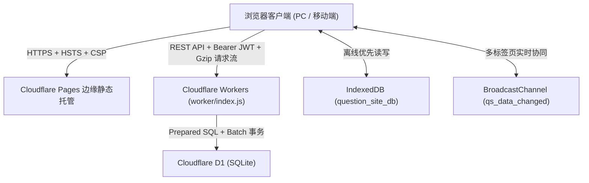

# 在线刷题系统 (Question Site)

[](https://workers.cloudflare.com/)
[](https://question-site-front.pages.dev)
[](./LICENSE)

一个基于 **纯 Cloudflare 无服务器架构**（Cloudflare Pages + Cloudflare Workers + Cloudflare D1 SQLite）的开源在线题库管理与智能刷题系统。前端采用原生 ES Modules（零运行时打包器依赖）与构建期静态 Tailwind CSS，支持离线优先 IndexedDB 存储、乐观锁三方合并、增量云同步、客户端 Gzip 流式压缩上传、SM-2 遗忘曲线间隔复习，以及独立于主题库的 107 套四六级/考研英语真题专项模块。

| 环境组件 | 线上地址 / 标识 |
| :--- | :--- |
| **用户端 (Cloudflare Pages)** | <https://question-site-front.pages.dev> |
| **管理后台 (Admin Console)** | <https://question-site-front.pages.dev/admin.html> |
| **后端 API (Cloudflare Worker)** | `https://question-site-api.combodevy-9b0.workers.dev` |
| **数据库 (Cloudflare D1)** | `question-site-db` (`128acd54-531e-4eba-9943-56768d095c98`) |
| **源码仓库 (GitHub)** | <https://github.com/combodevy/question-site> |
| **开源协议 (License)** | [MIT License](./LICENSE) |
| **当前版本** | `v 2610193`（版本格式：`YYMMDD` + 当日迭代序号） |

> **部署目标防呆说明**：`scripts/check-deploy-target.mjs` 在每次打包和部署前会自动强校验前端 `config.js`、Worker 名称与 D1 `database_id` 是否同属同一套环境（`production` / `mirror` / `mirror2`），杜绝跨环境交叉污染。

---

## 目录

1. [系统架构与数据流](#1-系统架构与数据流)
2. [核心功能矩阵](#2-核心功能矩阵)
3. [Cloudflare 网络传输与 D1 性能优化](#3-cloudflare-网络传输与-d1-性能优化)
4. [全栈安全加固矩阵（防渗透与防注入）](#4-全栈安全加固矩阵防渗透与防注入)
5. [规范化登录与注册流程](#5-规范化登录与注册流程)
6. [英语真题专项模块](#6-英语真题专项模块)
7. [项目目录结构](#7-项目目录结构)
8. [后端 API 接口契约](#8-后端-api-接口契约)
9. [自动化测试与 CI 契约检查](#9-自动化测试与-ci-契约检查)
10. [本地开发与线上部署指南](#10-本地开发与线上部署指南)
11. [版本更新日志 (Changelog)](#11-版本更新日志-changelog)

---

## 1. 系统架构与数据流



### 技术栈概览

| 层级 | 核心技术与设计选型 |
| :--- | :--- |
| **前端应用** | HTML5、Vanilla ES Modules（`js/app.js` 入口，无 Webpack/Vite 运行时黑盒）、静态预编译 Tailwind CSS（`css/tailwind.css`）、纯内联 SVG 矢量图标体系（全站零 Emoji、零中点符号）、原生高分屏 Canvas 图表、自托管 Inter 可变字体與本地 `pinyin-pro` 拼音引擎 |
| **本地存储** | IndexedDB（`question_site_db` / `keyval`）离线优先存储题库、作答历史、回收站与收藏列表；`localStorage` 存储轻量级用户偏好与练习勾选记忆 |
| **后端服务** | Cloudflare Workers（单文件无依赖 `worker/index.js`），基于原生 Web Crypto API 实现 HS256 JWT 签发/验签、PBKDF2-HMAC-SHA256（100,000 次迭代）密码哈希与恒定时间比对 |
| **持久化数据库** | Cloudflare D1 (SQLite)，包含 6 张核心表：`users`、`question_sets`、`questions`、`sync_logs`、`bank_snapshots`、`user_backups` |

---

## 2. 核心功能矩阵

### 2.1 题库导入中心（三步可视化 + 智能容错 + 预览调序）
- **三步流程进度条**：顶部实时指示 `① 选择或粘贴 JSON` -> `② 格式体检与预览` -> `③ 导入入库与同步`。
- **双通道输入**：支持选择/拖拽本地 `.json`/`.txt` 文件，或直接展开 **「粘贴 JSON 文本」** 面板（支持一键从剪贴板读取，自动剥离 Markdown ```` ```json ```` 代码围栏、AI 解释文字、BOM 头与 JS 注释）。
- **JSON 语法错误自动修复与行列级定位**：
  - 自动修复手写或 AI 生成 JSON 常见的对象/数组末尾多余逗号（Trailing Comma）；
  - 若存在未闭合括号/引号（如 AI 输出超长截断）或未转义双引号，精确计算出错的 **行号与列号**，在页面内高亮渲染出错行上下文代码与指针 `▲`，并支持一键将错误文本载入内置编辑框在线修改后重解析。
- **单题级坏题隔离（拒绝整包连坐）**：
  - 自动兼容顶层数组 `[...]`、`{ questions/data/items/list: [...] }`、`{ 科目: [题] }` 等多种外部结构；
  - 自动归一题型别名与答案写法（如多选数组 `["A","C"]` 或 `"A, C"` 归一为 `"AC"`，判断题 `"正确/错误/对/错/true/false/1/0"` 归一为 `"T/F"`）；
  - 若个别题目缺题干、缺答案或答案超出选项范围，自动将该题隔离记入 **「格式自动体检与修复」** 折叠明细，其余全部正常题目照常预览并导入。
- **导入前增改预检与导入后报告卡**：
  - 预览阶段即自动对比当前题库，展示 `预计新增 +X 道`、`同 ID 更新 ~Y 道`、`已存在跳过 =Z 道`；
  - 导入完成后提供 **「立即刷这批题 →」** 与 **「去题库查看 →」** 快捷入口。
- **预览阶段章节与科目调序**：
  - 支持在导入预览中通过上下箭头微调科目与章节顺序；
  - 内置中英文自然排序引擎（识别 `Chapter 1..10`、`第一章..第十二章` 等），检测到乱序章节（如 `Chapter 2, 3, 4, 1`）时自动弹出黄色提示条，支持一键按章节号自然排好。

### 2.2 总题库 / 错题本 / 已收藏 三合一视图与章节管理
- **三模式分段切换**：题库页顶部提供 **「总题库 / 错题本 / 已收藏」** 分段胶囊栏，实时显示三类题目数量角标；首页右侧同步提供「错题本 / 已收藏题目 / 总题库」三张统计卡片。
- **科目 + 章节二级联动筛选**：
  - 除按科目（`#lib-filter`）、题型（`#lib-type`）、排序方式（`#lib-sort`）与拼音/关键字搜索外，新增 **具体章节筛选器 (`#lib-chapter`)**；
  - 选中某科目时列出该科目全部章节及题量；在「全科目」下亦可直接按 `科目 / 章节` 一步筛选任意章节。
- **手动新增与编辑题目（含防呆设计）**：
  - 题库工具栏与科目管理弹窗均设有 **`+ 新增题目`** 按钮，自动带入当前正在筛选的科目与章节；
  - 支持 **「保存并继续下一题」**，连续录题无需重复选择科目与章节；
  - **防呆校验**：单选题模式下勾选「正确」自动互斥取消其他选项；拦截「勾选空白选项为正确答案」与「重复相同选项内容」；剔除空行后严格重算选项字母，杜绝答案字母错位。
- **科目 / 章节管理弹窗**：
  - 支持对已有科目和章节进行 **上移 / 下移** 调序、**按章节号一键自然排序**、**原位重命名**（重命名后保持原列表位置不跳至末尾）、**一键查看该章题目** 以及 **软删除至回收站**。

### 2.3 整章练习、自定义练习与固定顶栏刷题器
- **整章练习（原智能练习升级）**：
  - 首页点击「整章练习」可按科目浏览所有章节及题数，默认题数为「整章全部」；
  - 每章右侧配有 **「直练本章」** 按钮，一键即刻开刷整章；亦支持多章勾选合并练习并自动记忆勾选状态。
- **自定义练习（持久化勾选记忆 + 快捷栏）**：
  - 采用 `{ checked, seen }` 双集合持久化结构（`qs_setup_state_v2`），彻底修复「将某科目全部取消勾选后下次打开又被自动全勾回来」的问题；
  - 顶部提供 **「全选全部 / 清空全选 / 反选」** 与 **「只练单科」** 快捷胶囊；
  - 每张章节卡片显示题量，并提供 **「仅此章」**（一键只勾本章）与 **「直练」**（一键直接开练本章）按钮；
  - 底部支持切换 **「随机乱序 / 题库原序」** 并实时统计 `已选 X / Y 章（共 Z 题）`。
- **刷题页顶部固定切题栏（位置恒定不跳动）**：
  - 将 **「上一题 / 题号进度 / 重答本题 / 下一题」** 导航栏固定在题目卡片正上方（题干上方）；无论题干长短、选项多少或下方是否展开解析，导航按钮在屏幕上的垂直位置恒定不变，鼠标停在原处即可连续切题。
  - 支持展开 **「题卡」矩阵面板** 任意跳题（区分当前/已答对/已答错/未答）；
  - 完整保留本轮每道题的 **已作答回看状态**、**未提交多选/填空草稿**，并支持点击 **「重答本题」** 重新作答；
  - 支持全键盘流操作：`左/右方向键` 随时切换上下题，`A–H` / `1–8` 选择选项，`S` 收藏/取消收藏，`Enter` 提交或下一题。

---

## 3. Cloudflare 网络传输与 D1 性能优化

针对 Cloudflare Pages + Workers + D1 的计费模型与网络延迟特征，系统实施了以下五层传输与存储优化：

1. **Fast ETag 毫秒级 `304 Not Modified` 短路（节省 99.9% 轮询读取行配额）**：
   - 所有写路径（`save-question-set`、`push-broadcast`、`users-update-bank`）均严格递增 `question_sets.version`。
   - `GET /api/load-question-set` 在读取单行 `question_sets` 元数据后，立即构造轻量级版本指纹 `W/"s${setId}-v${version}-h${historyAfter}"` 并比对 `If-None-Match`；
   - 命中时直接返回 `304 Not Modified`，**完全跳过 `SELECT content FROM questions` 全表扫描、JSON 解析与 SHA-256 摘要计算**。
2. **消除全量保存时的双倍冗余载荷（请求体积直降 50%）**：
   - 旧实现在全量保存时同时上传 `questions` 数组与包含整份题库的 `state.bank`，导致同一批题目在单次 HTTP 请求中被重复序列化和传输两次。
   - 现前端在上传 `questions`（或 `skipQuestionsUpdate=true`）时仅传输轻量元数据 `wireState`，由 Worker 端在内存中从 `questions` 或既有状态毫秒级补齐 `finalState.bank`，实现云端快照与存储格式 100% 兼容的同时减半上传体积。
3. **客户端原生 Gzip 流式请求压缩（大题库上传带宽节省 85%–92%）**：
   - 当 `/api/save-question-set` 序列化载荷超过 `32KB` 时，前端自动调用浏览器原生 `CompressionStream('gzip')` 将请求体压缩为二进制流并附带 `Content-Encoding: gzip`；
   - Worker 端 `readJson()` 自动通过 `DecompressionStream('gzip')` 流式解压，1.5MB 题库实测上传仅需约 120KB。
4. **D1 多行合并批量插入（SQL 语句数减少 40 倍）**：
   - Worker 端 `buildQuestionInsertStatements()` 将逐题单行 `INSERT` 升级为每批最多 **40 行合并插入**（单条 SQL 绑定 80 个参数，严格低于 Cloudflare D1 单条语句 100 个绑定参数的硬上限），2,000 道题写入从 2,000 条 SQL 降至 50 条 SQL。
5. **增量状态同步 (`statePartial`) 与边缘缓存策略 (`_headers`)**：
   - 日常做题、收藏/取消收藏、移除错题仅触发 `statePartial: true` 增量同步，仅上传新增的 `historyAppend` 与变更的轻量字段；
   - `_headers` 为 `/fonts/*`、`/js/vendor/*`、`/english/papers/*` 配置 `Cache-Control: public, max-age=..., stale-while-revalidate=86400` 边缘缓存，而 `/version.json` 强制 `no-store` 确保版本更新即时感知。

---

## 4. 全栈安全加固矩阵（防渗透与防注入）

系统按行业安全标准对认证、传输、数据库与前端渲染进行了全链路加固：

| 安全维度 | 威胁场景 | 防护实现位置与机制 |
| :--- | :--- | :--- |
| **密码学与防时序枚举** | 密码哈希逐字节比对泄露时序；攻击者通过响应耗时差异枚举有效用户名；超长密码触发 PBKDF2 CPU DoS | 1. 密码采用 **PBKDF2-HMAC-SHA256（100,000 次迭代）** + 每用户独立 128-bit CSPRNG 随机盐；<br>2. 哈希比对采用恒定时间算法 `timingSafeEqualStr()`（逐字节异或累加）；<br>3. 登录接口在用户名不存在时执行等量虚拟 PBKDF2 计算，彻底抹平「用户存在 vs 不存在」的响应时间差；<br>4. 强制校验密码长度上限（`6–128` 字符），阻断超大字符串哈希算力耗尽攻击。 |
| **流式载荷限额与防 Zip 炸弹** | 攻击者伪造 `Content-Length: 10` 并使用 `Transfer-Encoding: chunked` 或高倍率 Gzip 炸弹打爆 Worker 128MB 内存 | `readJson(request, maxBytes)` 使用 `readStreamWithLimit()` 逐块读取底层字节流（含 `DecompressionStream` 解压后的真实字节数），认证接口限制 `16KB`、题库接口限制 `10MB`，一旦超限立即中断流并返回 `400`。 |
| **SQL 注入与 D1 参数溢出防护** | 恶意构造 SQL 元字符、`LIKE` 通配符 `%/_` 全表扫描、或单次勾选超 100 项触发 D1 `too many SQL variables` 崩溃 | 1. 全站 100% 采用参数化预编译语句 `env.DB.prepare(...).bind(...)`，零 SQL 字符串拼接；<br>2. 管理端搜索对 `%` 与 `_` 进行转义（`ESCAPE '\'`）；<br>3. 批量删除用户与题集采用 `chunkArray(..., 50)` 分块执行 `IN (...)`，永不触碰 D1 的 100 参数上限。 |
| **原型链污染防护 (Prototype Pollution)** | 导入或 API 写入含 `__proto__`、`constructor`、`prototype` 的科目/章节名导致服务端 500 崩溃或属性劫持 | 前后端（`worker/index.js`、`js/utils.js`、`js/data.js`）均内置 `UNSAFE_KEYS` 黑名单与 `isSafeKey()` 校验，并使用 `Object.create(null)` 与 `Object.prototype.hasOwnProperty.call` 构建题库字典。 |
| **XSS 与富媒体白名单净化** | 恶意题库在题干、选项、`media.html` 表格或 `data:image/svg+xml` 中注入可执行脚本 | 1. 所有题干、选项、解析、科目与章节名均经过 `escapeHTML()` 转义；<br>2. `sanitizeTableHTML()` 使用 `DOMParser` 解析后仅保留纯表格标签（`TABLE/THEAD/TBODY/TR/TH/TD` 等）并**剥离一切属性**；<br>3. 图片 `media.src` 仅允许 `https://` 或光栅图片 `data:image/(png\|jpeg\|gif\|webp);base64,`，拦截可执行脚本的 `data:image/svg+xml`。 |
| **CORS 与 HTTP 安全响应头** | 恶意站点跨域调用 API、子域名后缀欺骗、点击劫持、MIME 嗅探 | 1. `isOriginAllowed()` 严格解析 `new URL(origin)`，要求预览子域必须为 `https:` 协议且子域标签符合 `/^[a-z0-9-]+$/i`；<br>2. 全站注入 `Content-Security-Policy`、`Strict-Transport-Security (HSTS)`、`X-Frame-Options: DENY`、`X-Content-Type-Options: nosniff`、`Cross-Origin-Opener-Policy: same-origin`、`Referrer-Policy: no-referrer`。 |
| **暴力破解与接口限流** | 撞库爆破密码、批量脚本注册垃圾账号、恶意刷满错误日志表 | Isolate 内存滑动窗口限流：注册每 IP 每小时最多 5 次；登录每 IP 每 15 分钟最多 30 次，且单账号（IP+用户名）连续失败 10 次锁定 15 分钟；前端错误上报每用户每小时最多 30 条。 |

---

## 5. 规范化登录与注册流程

- **双模式独立切换（`#modal-auth`）**：
  - 顶部设有 **「账号登录 / 注册新账号」** 分段切换器，告别原本登录与注册按钮并排共用同一表单导致的误触注册问题。
- **注册模式（多重防呆）**：
  - **用户名规则实时提示**：`2–32` 位字母、数字、中文、下划线、点或横线（不含 `@`，禁止抢注 `ADMIN_USERNAMES` 保留名）。
  - **实时密码强度指示条**：输入密码时动态评估强度（不足 6 位红色提醒 / 中等琥珀色 / 高强度翠绿色）。
  - **确认密码二次核对**：注册模式下强制要求输入「确认密码」，前端先行核对两次输入一致后再发起请求，防止手误输错密码导致新账号无法再次登录。
- **反浏览器密码泄露弹窗干扰**：
  - 密码输入框采用 `type="text" autocomplete="off"` 配合 CSS `.pw-masked { -webkit-text-security: disc; }` 视觉掩码与 SVG 显隐切换按钮，并在登录/注册成功后立即清空 DOM 输入值，彻底避免浏览器密码管理器在测试简单密码时弹出全屏警告框。

---

## 6. 英语真题专项模块

首页点击「英语专题」卡片进入，是**与主题库完全隔离**的历年真题刷题模块（独立路由 `#/english`、独立本地存储键 `qs_eng_*`、不混入主题库统计）：

- **107 套真题全覆盖**：涵盖大学英语四级（CET-4）、六级（CET-6）与考研英语历年真题。
- **分节专项交互**：
  - **选词填空 / 完形填空**：文章内空位渲染为可点击胶囊槽位，点击弹出底部选词面板（面板顶部支持 `← 上一题 / 下一题 →` 快捷切题），交卷后文章内槽位实时着色显示正误；
  - **长篇阅读（段落匹配）**：选项渲染为紧凑的 `A–O` 段落字母芯片，文章自然段首标记高亮；
  - **仔细阅读 / Reading Part A**：桌面端左栏文章 sticky 常驻、右栏题目独立滚动；移动端支持底部文章抽屉，字号 `12–24px` 可调并持久化记忆。
- **答案速录与判分状态机**：支持 `26-30 CADBE` 区间格式粘贴答案（大小写宽容）；交卷后展示得分横幅与 **「重做本卷」** 按钮，再次打开已判分试卷时完整恢复得分横幅与重做入口。

---

## 7. 项目目录结构

```text
question-site-mirror2/
├── index.html                  # 用户端单页应用主入口（含全局样式与视图模板）
├── admin.html                  # 管理员后台控制台（单文件独立应用）
├── config.js                   # 前端环境配置（window.API_BASE）
├── package.json                # 构建、检查与部署脚本配置
├── tailwind.config.js          # Tailwind 静态编译配置
├── src/tailwind.css            # Tailwind 输入源样式
├── css/tailwind.css            # Tailwind 静态预编译产物（生产环境直接加载）
├── fonts/inter-var.woff2       # 自托管 Inter 可变字体
├── english/                    # 英语真题专项静态数据
│   ├── index-{cet4,cet6,kaoyan}.json
│   ├── keys.json               # 107 套真题标准答案库
│   └── papers/*.json           # 107 套分节试卷与带自然段边界的正文数据
├── js/
│   ├── app.js                  # 应用装配、容错初始化、版本检测、登录注册控制器
│   ├── auth.js                 # JWT 鉴权、会话管理、登出前未同步数据保护
│   ├── data.js                 # 核心数据层：题库/历史/回收站/收藏、乐观锁同步、Gzip 上传、SM-2
│   ├── quiz.js                 # 刷题引擎：上下题自由切换、题号卡、草稿保留、重答本题、键盘流
│   ├── ui.js                   # 弹窗/抽屉管理、三步导入中心、科目章节管理、题目编辑器、云备份对比
│   ├── utils.js                # 工具库：HTML/表格安全净化、自然排序、导入清洗与坏题隔离、编辑距离
│   ├── chart.js                # 高分屏自适应原生 Canvas 图表（折线/柱状/环形/30天热力图）
│   ├── router.js               # 视图路由切换与做题中途离开防护
│   ├── db.js                   # IndexedDB 异步键值存储封装
│   ├── dom.js                  # 安全 DOM 读写辅助
│   ├── prefs.js                # 每日目标与默认题量偏好
│   ├── i18n.js                 # 中英双语字典与 DOM 自动翻译引擎
│   ├── vendor/pinyin-pro.min.js# 本地托管拼音搜索库
│   └── views/                  # 视图模块
│       ├── dashboard.js        # 首页仪表盘、今日待复习、七日趋势、高频错题
│       ├── library.js          # 总题库/错题本/已收藏三栏视图、科目+章节筛选、增量懒加载
│       ├── setup.js            # 自定义练习配置（持久化勾选记忆、快捷选择栏、单章直练）
│       ├── analytics.js        # 学习分析报告（总览/单科、热力图、耗时排行、题目详情浮层）
│       ├── profile.js          # 个人空间（核心统计、科目掌握度、最近动态、成就墙）
│       └── english.js          # 四六级/考研英语真题专项视图
├── worker/
│   ├── index.js                # Cloudflare Worker 后端 API（鉴权、同步、备份、管理端接口）
│   ├── wrangler.json           # Worker 与 D1 数据库绑定配置
│   └── migrations/             # D1 SQLite 数据库建表迁移脚本
└── scripts/
    ├── ci-check.mjs            # 全量 26 个 JS/MJS 文件语法检查
    ├── check-deploy-target.mjs # 部署环境防交叉污染校验（config.js <-> wrangler.json <-> D1）
    ├── check-dom-contract.mjs  # DOM 契约检查（data-act、id 引用、CSS 变量、inline 事件）
    ├── check-i18n.mjs          # 国际化字典 100% 覆盖检查（零中文残留）
    ├── validate-keys.mjs       # 英语真题答案库契约校验
    ├── audit-data.py           # 107 套英语真题结构与编码审计
    └── stage-pages.mjs         # Cloudflare Pages 产物打包与安全响应头 (_headers) 生成
```

---

## 8. 后端 API 接口契约

### 8.1 认证与账户接口
| 方法与路径 | 鉴权 | 功能说明 |
| :--- | :--- | :--- |
| `POST /api/auth/signup` | 公开 | 注册新账号（校验用户名 `2–32` 位合法字符、密码 `6–128` 位、防抢注管理员名、IP 限流），返回 7 天有效 HS256 JWT |
| `POST /api/auth/login` | 公开 | 账号登录（含 IP 与账号双层防爆破锁定、恒定时间哈希比对、防枚举等量 PBKDF2 计算），返回 JWT |
| `GET /api/auth/me` | Bearer JWT | 获取当前登录用户资料、注册时间、是否为管理员及云端题量统计 |
| `POST /api/auth/change-password` | Bearer JWT | 验证原密码并更新密码（重新生成 CSPRNG 盐值与 PBKDF2 哈希） |
| `POST /api/auth/delete-account` | Bearer JWT | 验证密码后级联彻底删除当前账号及其所有题集、题目、日志、快照与备份 |

### 8.2 题库同步与备份接口
| 方法与路径 | 鉴权 | 功能说明 |
| :--- | :--- | :--- |
| `GET /api/load-question-set` | Bearer JWT | 加载题库与学习状态（支持 `?historyAfter=` 增量历史拉取与 Fast ETag `304 Not Modified` 毫秒级短路） |
| `POST /api/save-question-set` | Bearer JWT | 保存题库与状态（支持 `Content-Encoding: gzip` 压缩请求体、`statePartial` 增量同步、乐观锁 `409 Conflict` 检测、24h 自动快照与 D1 多行合并写入） |
| `GET /api/user-backups` | Bearer JWT | 获取云端备份列表（或带 `?id=N` 获取单份完整备份载荷） |
| `POST /api/user-backups` | Bearer JWT | 创建题库（`bank`）或作答记录（`history`）云端备份，每类自动滚动保留最近 5 份 |
| `GET /api/sync-logs` | Bearer JWT | 查询当前用户最近 50 条云端同步日志 |
| `POST /api/client-errors` | Bearer JWT | 上报前端未捕获异常至 `sync_logs`（按用户限流） |

### 8.3 管理员后台接口（`/api/admin/*`，需满足 `ADMIN_USERNAMES` 白名单）
| 方法与路径 | 功能说明 |
| :--- | :--- |
| `GET /api/admin/users-list` | 分页获取用户列表（支持 `?page=&pageSize=&q=` 搜索，含最近活跃时间、IP、设备 UA 与题库数） |
| `POST /api/admin/create-user` | 管理员手动创建新用户 |
| `POST /api/admin/delete-users` | 批量删除指定用户（分块级联清理所有关联表，禁止删除当前登录管理员自身） |
| `POST /api/admin/reset-user-password` | 重置指定用户密码（用于用户忘记密码时的运营兜底） |
| `GET /api/admin/users-sets` | 查看指定用户的题集列表与题目数量 |
| `GET /api/admin/set-details` | 查看指定题集的全部题目内容与版本信息 |
| `POST /api/admin/users-update-bank` | 管理员修改并覆盖指定用户的题集（保留用户原有作答历史与收藏） |
| `POST /api/admin/push-broadcast` | 向单个、多个或全体用户追加推送广播题库（带题目指纹去重与独立 UUID 分配） |
| `GET /api/admin/system-logs` | 查看全站最近 100 条同步与客户端异常日志 |

---

## 9. 自动化测试与 CI 契约检查

每次修改后均须运行以下全量检查脚本，确保零语法错误、零悬空 DOM 引用、零残留未翻译文案：

```bash
# 1. 重新编译静态 Tailwind CSS
npm run build:css

# 2. 全量 JS/MJS 语法检查（覆盖前端、脚本与 Worker 共 26 个文件）
node scripts/ci-check.mjs

# 3. 部署目标一致性防呆检查（确保 config.js、Worker 与 D1 指向同一套 mirror2 环境）
node scripts/check-deploy-target.mjs

# 4. DOM 契约检查（校验 data-act、DOM id 引用、CSS 变量定义、inline 事件调用）
node scripts/check-dom-contract.mjs

# 5. 国际化覆盖检查（校验 index.html 与 js/ 下全部中文文案在英文模式下 100% 翻译）
node scripts/check-i18n.mjs

# 6. 英语真题答案库与数据完整性校验
node scripts/validate-keys.mjs
python scripts/audit-data.py
```

---

## 10. 本地开发与线上部署指南

### 10.1 本地开发
```bash
# 1. 安装依赖
npm install

# 2. 启动本地 Worker 与本地 D1 数据库（终端 1）
cd worker
npx wrangler d1 migrations apply question-site-mirror2-db --local
npx wrangler dev --port 8787

# 3. 打包并启动本地 Pages 静态服务器（终端 2）
node scripts/stage-pages.mjs
npx wrangler pages dev .pages-dist --port 8788
```

### 10.2 线上部署（Cloudflare Workers + Cloudflare Pages）
```bash
# 1. 构建静态 CSS 并执行检查
npm run build:css
node scripts/ci-check.mjs
node scripts/check-dom-contract.mjs
node scripts/check-i18n.mjs

# 2. 部署后端 Cloudflare Worker
cd worker
npx wrangler deploy
cd ..

# 3. 组装前端静态产物 (.pages-dist) 并部署至 Cloudflare Pages
node scripts/stage-pages.mjs
npx wrangler pages deploy .pages-dist --project-name question-site-front --branch main --commit-dirty=true
```

---

## 11. 版本更新日志 (Changelog)

### `v 2610193` (2026-10-19)
- **真实浏览器（Playwright + Chrome）全链路动态测试与修复**：
  - **刷题容器内滚与顶栏零位移锁定**：将 `#view-quiz` 设为视口内定高布局（`h-[calc(100vh-5.5rem)] overflow-hidden`），将滚动收敛至 `.quiz-card` 内部的 `#quiz-body`，使「上一题 / 题号 / 下一题」顶栏完全独立于长题干和底部解析区滚动，在真实浏览器中验证连续切题与展开解析时按钮 Y 坐标恒定在 `180px`（0 像素跳动）；
  - **修复导入横幅「审查相似题」内联调用名不匹配**：修复 `js/ui.js` 导入结果横幅中 `openSimilarReviewModal()` 与定义名 `openSimilarReview()` 不一致的动态点击报错，并升级 `scripts/check-dom-contract.mjs` 同时扫描 HTML 与全部 `js/**/*.js` 模板字符串中的内联事件（共 155 处调用）；
  - **修复答题期间后台云拉取提前解除同步抑制锁**：在 `loadFromCloud()` 完成回调中检查 `App.quiz.isActive()`，避免做题期间后台拉取完成意外将 `_suppressCloudSync` 置回 `false`；
  - **补齐内联矢量 Favicon**：为 `index.html` 与 `admin.html` 注入 SVG Data URL Favicon，消除浏览器控制台默认请求 `/favicon.ico` 产生的 `404 Not Found` 报错。

### `v 2610192` (2026-10-19)
- **后端安全加固与 Cloudflare 传输/D1 优化**：
  - 新增 `readStreamWithLimit` 与 `DecompressionStream('gzip')` 流式请求体读取，支持客户端 Gzip 压缩上传并彻底防御 `Transfer-Encoding: chunked` 绕过 `Content-Length` 及 Zip 炸弹攻击；
  - 新增 `timingSafeEqualStr` 恒定时间哈希比对；登录接口在用户不存在时执行等量虚拟 PBKDF2 计算，消除用户名枚举时序侧信道；所有密码输入强制 `6–128` 字符上限；
  - `GET /api/load-question-set` 引入 Fast ETag (`W/"s${setId}-v${version}-h${historyAfter}"`) 短路机制，未变更时在读取 `questions` 表前直接返回 `304 Not Modified`；
  - `POST /api/save-question-set` 消除全量保存时 `questions` 与 `state.bank` 的双倍冗余传输（节省 50% 请求体积），配合前端 `CompressionStream('gzip')` 压缩进一步降低约 90% 上传流量；
  - 新增 `buildQuestionInsertStatements` 多行合并写入（每条 SQL 批量插入 40 题），将大题库写入 D1 的 SQL 语句数缩减 40 倍；批量删除采用 50 条分块查询/删除，防止触碰 D1 单语句 100 参数上限；
  - 全链路拦截 `__proto__`、`constructor`、`prototype` 等危险键名，修复原型链污染风险；图片 `media.src` 限制为 `https://` 或光栅图 `data:image/(png|jpeg|gif|webp);base64,`。
- **规范化登录与注册流程**：
  - 登录弹窗升级为「账号登录 / 注册新账号」分段切换模式；
  - 注册模式新增用户名格式规则提示、实时密码强度指示条与「确认密码」二次核对框；移除重复绑定的 `Enter` 事件。
- **全局防溢出加固**：
  - 为题干、选项、解析、列表与弹窗注入 `overflow-wrap: anywhere; word-break: break-word;`，防止超长无空格英文、代码或 URL 撑破容器。

### `v 2610191` (2026-10-19)
- **顶栏、首页与刷题布局升级**：
  - 移除顶栏与导出页脚的 `LMS Genesis` 字样，启用 `v YYMMDDN` 版本号规则；
  - 刷题页「上一题 / 题号 / 下一题」导航栏移至题目卡片正上方固定位置，消除因题目或解析高度变化引起的按钮跳动；
  - 首页「智能练习」升级为「整章练习」，支持单章一键开刷与多章勾选记忆；
  - 修复「自定义练习」在取消勾选整个科目后记忆丢失的 Bug，新增「全选全部 / 清空全选 / 反选 / 只练单科」与每章「仅此章 / 直练」按钮及顺序切换；
  - 全站清除所有 Emoji 与 `·` / `•` 符号，全面统一为内联 SVG 矢量图标；
  - 支持在「题库导入中心」与「科目/章节管理」中手动上下移动章节/科目及一键按章节号自然排序；题库页新增「全章节」联动筛选与 `+ 新增题目`（含「保存并继续下一题」）。

---

## 12. 开源协议 (License)

本项目基于 **[MIT License](./LICENSE)** 开源。你可以自由地使用、复制、修改、合并、发布和分发本项目代码。

