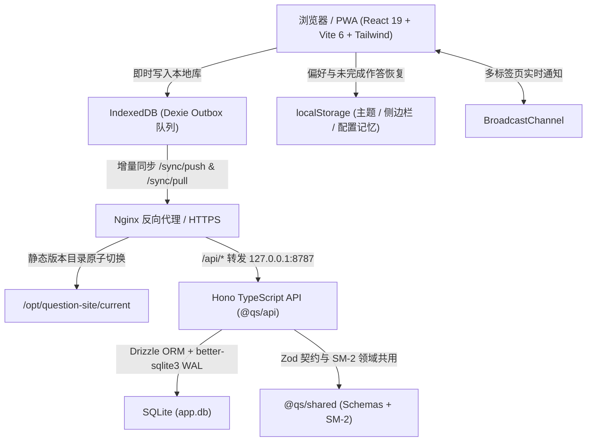

# 在线刷题与记忆巩固平台 (Question Site)

[](https://quiz.devy.cc.cd)
[](https://github.com/combodevy/question-site)
[](https://quiz.devy.cc.cd)
[](./LICENSE)

一个基于 **TypeScript Monorepo** 架构打造的离线优先在线题库管理与间隔记忆刷题平台（`@qs/shared` + `@qs/api` Hono & Drizzle SQLite + `@qs/web` React 19 + Vite 6 + Dexie Outbox SPA）。支持 **PWA 离线运行**、细粒度幂等增量同步（`opId` Outbox 队列）、SM-2 遗忘曲线调度、107 套四六级/考研英语历年真题独立作答模块，以及内置服务器遥测的现代化管理控制台（Admin Console）。

| 环境组件 | 线上地址 / 标识 | 架构说明 |
| :--- | :--- | :--- |
| **生产网站 (Official Live)** | <https://quiz.devy.cc.cd> | 独立生产服务器（`47.111.142.133`，Nginx 原子发布与反向代理） |
| **管理后台 (Admin Console)** | <https://quiz.devy.cc.cd/admin.html> | 独立 Vite 入口（运维监控 / 用户 360° 档案 / 题库编辑器 / 全站广播下发） |
| **后端 API (Production)** | `https://quiz.devy.cc.cd/api` | TypeScript Hono 服务 + `better-sqlite3`（WAL 模式）+ Drizzle ORM（`8787` 端口） |
| **源码仓库 (GitHub)** | <https://github.com/combodevy/question-site> | 主分支 `main`，npm workspaces + Vitest 前后端自动化测试 |
| **开源协议 (License)** | [MIT License](./LICENSE) | 宽松开源许可协议 |
| **当前版本** | `v3.0.0` | TypeScript Monorepo 全栈演进版 |

---

## 目录

1. [系统架构与数据流](#1-系统架构与数据流)
2. [核心功能矩阵](#2-核心功能矩阵)
   - 2.1 [题库导入中心与多维题库管理](#21-题库导入中心与多维题库管理)
   - 2.2 [沉浸式刷题、自动切题与首页进度恢复](#22-沉浸式刷题自动切题与首页进度恢复)
   - 2.3 [自定义练习配置与全量选择记忆](#23-自定义练习配置与全量选择记忆)
   - 2.4 [多维学习分析与高频错题透视](#24-多维学习分析与高频错题透视)
   - 2.5 [全局 GPU 动效系统与无障碍减动效支持](#25-全局-gpu-动效系统与无障碍减动效支持)
   - 2.6 [英语真题专项模块 (107 套历年真题)](#26-英语真题专项模块-107-套历年真题)
   - 2.7 [管理后台 (Admin Console) 与运维看板](#27-管理后台-admin-console-与运维看板)
3. [细粒度增量同步与离线安全设计](#3-细粒度增量同步与离线安全设计)
4. [全栈安全矩阵](#4-全栈安全矩阵)
5. [项目目录结构](#5-项目目录结构)
6. [后端 API 接口契约](#6-后端-api-接口契约)
7. [自动化测试与契约校验](#7-自动化测试与契约校验)
8. [本地开发、生产部署与一键回滚](#8-本地开发生产部署与一键回滚)
9. [开源协议 (License)](#9-开源协议-license)

---

## 1. 系统架构与数据流



### 技术栈概览

| 层级 | 核心技术与设计选型 |
| :--- | :--- |
| **前端应用 (`@qs/web`)** | React 19、TypeScript、Vite 6、Tailwind CSS、Zustand 状态管理、TanStack Query、`lucide-react` 矢量图标、原生 SVG 数据可视化、自托管 `InterVar` 可变字体、本地 `pinyin-pro` 拼音简拼搜索、`mammoth` (`.docx`) 与 `pdfjs-dist` (`.pdf`) 本地解析 |
| **共享领域层 (`@qs/shared`)** | Zod 严格入参校验契约（Question / Auth / Sync v2）与 SM-2 间隔重复算法实现 |
| **离线与持久化** | `vite-plugin-pwa` 自动生成 Service Worker；Dexie.js 管理用户隔离 IndexedDB（题目 / 回收站 / 历史记录 / 星标错题标志 / 英语进度 / `outbox` 待传变更队列） |
| **后端服务 (`@qs/api`)** | Node 22 + Hono + Drizzle ORM + `better-sqlite3`（WAL 日志模式与外键约束），通过 `esbuild` 打包为单文件运行时产物 `dist/server.mjs`，内置 v1 到 v2 数据库自动平滑迁移器 |
| **持久化表结构** | v2 规范表：`v2_refresh_tokens`、`v2_user_sync_meta`、`v2_questions`、`v2_answer_history`、`v2_question_flags`、`v2_english_progress`、`v2_applied_ops`；同时保留兼容表 `users`、`question_sets`、`questions`、`sync_logs`、`bank_snapshots`、`user_backups` |

---

## 2. 核心功能矩阵

### 2.1 题库导入中心与多维题库管理
- **多格式导入解析 (`ImportCenterModal`)**：支持 `.json`、`.txt`、Word（`.docx`）与 `.pdf` 解析导入；具备宽松 JSON 修复、错误行列定位、损坏题目单题隔离及章节自然序号识别。
- **默认展开答案与卡片点击显隐 (`LibraryView`)**：题库页面默认展示全部标准答案与解析（可通过右上角开关一键切换全局隐藏/显示并记忆状态），点击任意题目卡片表面即可快速切换该题答案显隐。
- **11 维智能排序与条件徽章展示 (`libraryUtils`)**：支持默认顺序、错误率从高到低/从低到高、累计错题次数、首字母拼音 A-Z / Z-A、作答次数、标准答案排序、最近编辑与 SM-2 到期优先；**错误率徽章仅在选择错误率排序时展示**，保持日常浏览界面清爽。
- **多选批量处理与新建科目**：支持本页全选/反选/筛选全选与单题复选框多选，一键执行 **批量换科目或换章节**（可直接选择或输入全新科目与章节名称）、批量收藏、批量练题、批量导出 JSON、批量移入回收站，以及回收站批量恢复/彻底删除；同步提供 `新增科目` 与 `章节管理`（`BankManagerModal`）弹窗。

### 2.2 沉浸式刷题、自动切题与首页进度恢复
- **作对自动下一题与防重入**：开启 `答对后自动下一题`（默认开启，支持在刷题顶栏或偏好页随时切换）后，答对题目会短暂展示绿色反馈并在 `650ms`（含图/表/阅读材料为 `1000ms`）后自动跳转下一题；手动切题、点击 `重做本题` 或退出练习均会自动取消待执行定时器。
- **意外退出 / 关闭浏览器进度恢复**：刷题过程中的题目队列、当前题号与作答状态实时按用户写入 `localStorage`；若中途误关页面未结算交卷，再次打开首页（`DashboardView`）时自动弹出恢复窗口，可选择 **继续上次刷题** 或点击关闭 / `放弃并关闭` 清理暂存。
- **富媒体与分栏阅读**：自动识别题干中的图片/净化表格占位符；存在 `psg` 长文材料时桌面端自动启用左文右题 Sticky 分栏，移动端提供全屏阅读抽屉；完整支持键盘快捷键（`1-9` / `A-I` 作答，`左/右方向键` / `Enter` 切题，`S` 收藏）。

### 2.3 自定义练习配置与全量选择记忆
- **双列图标化练习模式卡片 (`PracticeSetupView`)**：提供 `随机抽题`、`顺序通刷`、`SM-2 复习`、`错题攻坚`、`收藏专练` 五种模式卡片，直观展示到期复习数、待攻坚错题数与收藏数。
- **选择状态完整记忆**：基于 `{ mode, type, limit, checked, seen }` 结构写入 `localStorage`，精准记住上一次选中的模式、题型、题数与勾选章节（取消勾选或清空全选后刷新不会回弹，新导入章节自动默认勾选）；提供 `全选`、`反选`、`清空`、单科 `仅此科` 与单章 `仅此章` / `直练` 快捷操作。

### 2.4 多维学习分析与高频错题透视
- **全科概览 / 单科深度双视角 (`AnalyticsView`)**：视角切换状态持久化记忆。
- **全景统计图表**：6 项核心 KPI 指标、近 30 日做题量柱状与正确率折线叠加 SVG 图、12 周打卡热力图与题型统计、**作答耗时环形图**（`<5s`、`5-15s`、`15-30s`、`30-60s`、`>60s`）、**SM-2 遗忘临界分布**、各科目强弱项诊断对比及 `耗时最久 TOP 10`。
- **高频错题与题目洞察抽屉全量答案展示**：`高频错题 TOP 榜` 卡片内与点击展开的右侧洞察抽屉（`QuestionInsightDrawer`）均基于共享 [QuestionPreviewBlock](file:///C:/Users/22636/.gemini/antigravity/scratch/question-site/apps/web/src/components/ui/QuestionPreviewBlock.tsx) 完整渲染选项、绿色高亮正确项、参考答案、解析与历史作答时间线。

### 2.5 全局 GPU 动效系统与无障碍减动效支持
- 在 [index.css](file:///C:/Users/22636/.gemini/antigravity/scratch/question-site/apps/web/src/styles/index.css) 定义纯 `transform` / `opacity` 合成层动画（入场 `.anim-page-in`、弹窗 `.anim-modal-in`、抽屉 `.anim-drawer-in`、通知 `.anim-toast-in`、切题 `.anim-question-in`、答案/批量栏 `.anim-slide-down`、答对 `.anim-pop-in`、答错微震 `.anim-shake`、图表生长 `.anim-bar-grow` / `.anim-bar-x` 及错峰 `.anim-stagger`）。
- 所有入场动画结束态归零至 `transform: none`，避免破坏子容器内的 `position: sticky` 与 `position: fixed`；自动适配系统 `@media (prefers-reduced-motion: reduce)` 无障碍设置。
- 左侧导航栏（`ShellLayout`）支持折叠/展开记忆，直接展示当前登录用户名，移动端提供顶部状态栏与底部 Dock。

### 2.6 英语真题专项模块 (107 套历年真题)
- [EnglishView.tsx](file:///C:/Users/22636/.gemini/antigravity/scratch/question-site/apps/web/src/features/english/EnglishView.tsx) 覆盖 `english/` 目录下的四级（CET-4）、六级（CET-6）与考研英语真题（与主题库统计完全隔离）。
- 支持选词填空点击槽位与上下题面板联动、段落匹配字母芯片、阅读分栏字号记忆、区间格式快速录入答案及交卷判分，并通过 `v2_english_progress` 云端增量同步。

### 2.7 管理后台 (Admin Console) 与运维看板
- 独立入口 [admin.html](file:///C:/Users/22636/.gemini/antigravity/scratch/question-site/apps/web/admin.html) + `apps/web/src/admin/*`，需管理员身份访问：
  - **系统概览与硬件运维 (`AdminOpsView`)**：查看注册用户/有效题数/活跃数、CPU Loadavg、内存与磁盘容量、`app.db` 及备份文件体积，触发热备份或服务重启，并实时查看 API / Nginx 日志。
  - **用户资产与 360° 档案 (`AdminUsersView`)**：支持建号、搜索分页、密码重置（重置即使旧 Token 失效）、360° 学习档案抽屉、全量 JSON 数据导出及批量删除。
  - **云端题库编辑与全局下发 (`AdminBankEditorView` / `AdminBroadcastView`)**：在线修改用户题库，或通过 JSON/纯文本/Word/PDF 解析向指定或全部用户广播下发新题目（自动指纹去重）。

---

## 3. 细粒度增量同步与离线安全设计

1. **Outbox 离线操作队列 (`apps/web/src/sync/engine.ts`)**：每次录题、删题、恢复、改题、提交答题历史、收藏/隐藏错题或提交英语进度先原子写入本机 Dexie 数据库并生成唯一 `opId` 入队，随后防抖触发 `/api/sync/push`；网络中断或登录凭证过期时进度安全驻留本地等待恢复同步。
2. **服务端幂等去重与序列游标 (`routes/sync-v2.ts`)**：`v2_applied_ops` 主键拦截重复 `opId` 重试，`syncSeq` 单调递增支持客户端通过 `/api/sync/pull?since=` 精准拉取差异更新。
3. **Refresh Token 轮换与 401 防死锁 (`lib/api.ts`)**：支持并发请求共享单一 `refreshAccessToken()` in-flight 锁；当刷新凭证失败或返回 `401` 时立即中止同步轮询并提示重新认证，绝不丢失未上传 Outbox 变更。

---

## 4. 全栈安全矩阵

- **密码哈希与防枚举**：PBKDF2-HMAC-SHA256 + 每用户独立随机盐 + 恒定时间比对（`timingSafeEqual`），不存在账号执行等效虚拟计算抹平耗时差异。
- **鉴权与会话控制**：Access JWT + SHA-256 Refresh Token（轮换与服务端吊销支持、`tokenVersion` 改密即全端失效）。
- **请求体与输入防护**：全链路 Zod 结构校验、限制 JSON 最大字节数并支持 Gzip 流式压缩上传、防原型链污染键名过滤（`isSafeKey`）。
- **SQL 与 XSS 防护**：SQLite 100% 参数化/ORM 查询；富媒体表格采用 `DOMParser` 白名单标签净化且剥离事件属性，外链图片限制安全协议。
- **限流与安全响应头**：登录/注册/运维敏感路由独立滑动窗口限流；统一注入 CSP、HSTS、`X-Frame-Options` 等安全头与 CORS 白名单校验。

---

## 5. 项目目录结构

```text
question-site/
├── package.json                       # npm workspaces 根配置与脚本入口
├── tsconfig.base.json                 # TypeScript 基础编译配置
├── packages/
│   └── shared/src/                    # 共享 Zod 契约与核心领域逻辑 (@qs/shared)
│       ├── domain/sm2.ts              # SM-2 间隔记忆计算核心
│       └── schemas/{question,auth,sync}.ts
├── apps/
│   ├── api/                           # Node + Hono + Drizzle SQLite API (@qs/api)
│   │   ├── src/{app,config,server,types}.ts
│   │   ├── src/db/{index,schema,migrate-v2,migrate-cli}.ts
│   │   ├── src/middleware/{auth,cors,rate-limit}.ts
│   │   ├── src/routes/{auth,sync-v2,admin,ops,legacy-compat}.ts
│   │   └── tests/{auth,migration,sync-v2,legacy-compat}.test.ts
│   └── web/                           # React 19 + Vite 6 + Tailwind SPA (@qs/web)
│       ├── index.html                 # 用户端入口
│       ├── admin.html                 # 管理端入口
│       ├── src/
│       │   ├── styles/index.css       # 全局主题 Token 与 GPU 合成层动效系统
│       │   ├── db/index.ts            # Dexie.js 本机持久化存储架构
│       │   ├── sync/{engine,hooks}.ts # Outbox 增量同步引擎与统计派生 Hooks
│       │   ├── store/                 # Zustand 状态（认证 / 刷题恢复 / 同步 / 偏好）
│       │   ├── components/            # ShellLayout 与 UI 原语（Modal/Toast/Preview 等）
│       │   ├── features/              # 业务视图（Dashboard/Setup/Quiz/Library/Analytics/English/Profile/Auth）
│       │   └── admin/                 # 管理控制台视图套件
│       └── tests/                     # 单元测试与禁止符号/排错防护测试
├── english/                           # 107 套四六级/考研真题静态数据与标准答案库 keys.json
├── fonts/                             # 自托管 InterVar 可变字体
└── scripts/                           # DOM / i18n / 英语答案库契约校验与资产审计脚本
```

---

## 6. 后端 API 接口契约

| 分组 | 路径挂载点 (`app.ts`) | 主要接口 |
| :--- | :--- | :--- |
| **认证与账户** | `/api/auth` | `POST /signup`、`POST /login`、`POST /refresh`、`POST /logout`、`GET /me`、`POST /change-password`、`POST /delete-account` |
| **细粒度增量同步** | `/api/sync` | `POST /push`（提交 Outbox 变更操作数组）、`GET /pull`（按 `since` 游标拉取增量变动） |
| **传统兼容层** | `/api` | `GET /load-question-set`、`POST /save-question-set`、`GET / POST /user-backups`、`GET /sync-logs`、`POST /client-errors` |
| **管理员与运维** | `/api/admin` & `/api/admin/server-ops` | `GET /overview-stats`、`GET /users-list`、`GET /user-dossier`、`GET /user-export`、`POST /create-user`、`POST /delete-users`、`POST /reset-user-password`、`POST /push-broadcast`、`GET /users-sets`、`GET /set-details`、`POST /users-update-bank`、`GET /system-logs`、`GET /metrics`、`POST /action` |

---

## 7. 自动化测试与契约校验

任何功能改动交付前均需运行完整检验：

```bash
# 安装全工作区依赖
npm install

# 1. 全工作区 TypeScript 类型检查 (@qs/shared, @qs/api, @qs/web)
npm run typecheck

# 2. 前后端 Vitest 单元测试（包含动效/排序/解析/同步/认证/迁移/UI符号规范测试）
npm run test:web
npm run test:api

# 3. 生产包构建
npm run build:web
npm run build:api

# 4. 传统资源与英语真题契约审计
node scripts/check-dom-contract.mjs
node scripts/check-i18n.mjs
node scripts/validate-keys.mjs
```

---

## 8. 本地开发、生产部署与一键回滚

### 8.1 本地开发启动
```bash
# 终端 1：启动后端 API 服务（需设置不少于 16 位的 JWT_SECRET，默认端口 8787）
export JWT_SECRET="replace-with-local-dev-secret-at-least-16-chars"
export DB_PATH="./local-dev.db"
npm run dev:api

# 终端 2：启动 Vite 前端开发服务器（默认 5173，自动代理 /api -> 127.0.0.1:8787）
npm run dev:web
```

### 8.2 生产服务器部署架构 (`47.111.142.133`)
- **运行服务**：`question-site-api.service`（运行 `apps/api/dist/server.mjs`，监听 `127.0.0.1:8787`），`Nginx` 托管前端静态版本目录 `/opt/question-site/current` 并反代 `/api`。
- **原子版本发布与静态共享目录**：每次发布构建 `apps/web/dist` 至 `/opt/question-site/releases/<commit_sha>`，挂载共用静态目录（`english`、`fonts`、`media`、`403.html`、`404.html`、`version.json`），通过 `ln -sfn` + `mv -Tf` 原子切换 `/opt/question-site/current` 软链并 `systemctl reload nginx`；若服务端代码有变动则执行 `/opt/question-site/manage.sh restart`。
- **基线溯源与秒级回滚**：每次发布前在本地、GitHub 远端与服务器同步打好基线标签（如 `backup-pre-global-animations`）并保留历史 `/opt/question-site/releases/<prev_sha>` 与数据库快照；如遇回退需求，只需将 `/opt/question-site/current` 原子切回上一版本目录或复位 `git reset --hard <tag>` 并重载服务即可。

---

## 9. 开源协议 (License)

本项目基于 **[MIT License](./LICENSE)** 开源。您可以自由地使用、复制、修改、合并、发布和分发本项目代码。
