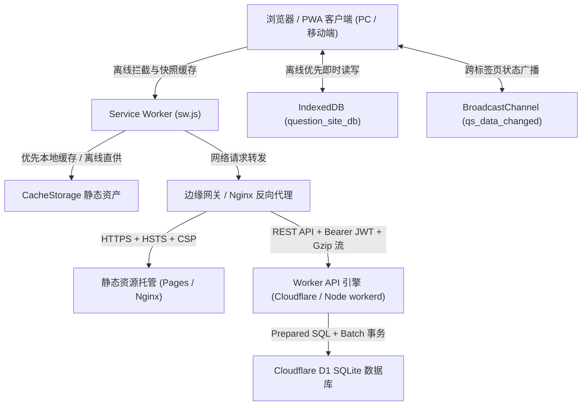

# 在线刷题系统 (Question Site)

[](https://workers.cloudflare.com/)
[](https://quiz.devy.cc.cd)
[](https://quiz.devy.cc.cd)
[](./LICENSE)

一个基于 **无服务器边缘架构与独立生产服务双模驱动**（Cloudflare Pages + Workers + D1 / 独立 Linux Ubuntu + Nginx + Node Wrangler Runtime）的开源在线题库管理与智能刷题系统。前端采用原生 ES Modules（零运行时打包依赖）与构建期静态 Tailwind CSS，支持 **PWA 100% 离线冷启动**、离线优先 IndexedDB 存储、多端乐观锁弹性三方合并（彻底消除 Version Conflict）、增量云同步、客户端 Gzip 流式压缩上传、SM-2 遗忘曲线间隔复习，以及独立于主题库的 107 套四六级/考研英语真题专项模块与全新重构的现代化全功能管理控制台（Admin Console）。

| 环境组件 | 线上地址 / 标识 | 架构说明 |
| :--- | :--- | :--- |
| **生产网站 (Official Live)** | <https://quiz.devy.cc.cd> | 独立生产服务器（47.111.142.133，Nginx + 本地 D1/Worker 守护进程） |
| **管理后台 (Admin Console)** | <https://quiz.devy.cc.cd/admin.html> | 全新重构后台（数据看板 / 智能查重体检 / 题目批量操作 / 深色模式） |
| **边缘镜像 (Cloudflare Pages)** | <https://question-site-front.pages.dev> | Cloudflare 全球边缘静态托管镜像 |
| **后端 API (Production)** | `https://quiz.devy.cc.cd/api` | Nginx 反向代理至本地 Wrangler 运行时（8787 端口） |
| **云端 API (Cloudflare Worker)** | `https://question-site-api.combodevy-9b0.workers.dev` | Cloudflare Workers 边缘计算无服务器 API |
| **持久化数据库 (Cloudflare D1)** | `question-site-db` (`128acd54-531e-4eba-9943-56768d095c98`) | 生产环境 D1 SQLite 持久化数据库 |
| **源码仓库 (GitHub)** | <https://github.com/combodevy/question-site> | 主分支 `main`，严格自动化契约检验 |
| **开源协议 (License)** | [MIT License](./LICENSE) | 宽松开源许可协议 |
| **当前版本** | `v 2611231` | 版本格式：`YYMMDD` + 当日迭代序号 |

> **部署目标防呆说明**：`scripts/check-deploy-target.mjs` 在每次打包和部署前会自动强校验前端 `config.js`、Worker 名称与 D1 `database_id` 是否同属同一套环境（`production` / `mirror` / `mirror2`），杜绝跨环境交叉污染；同时 `config.js` 具备自适应同源检测，自托管生产环境无缝直连本地反向代理 API。

---

## 目录

1. [系统架构与数据流](#1-系统架构与数据流)
2. [核心功能矩阵](#2-核心功能矩阵)
   - 2.1 [题库导入中心（三步可视化 + 智能容错 + 预览调序）](#21-题库导入中心三步可视化--智能容错--预览调序)
   - 2.2 [总题库 / 错题本 / 已收藏 三合一视图与章节管理](#22-总题库--错题本--已收藏-三合一视图与章节管理)
   - 2.3 [整章练习、自定义练习与顶栏固定刷题器](#23-整章练习自定义练习与顶栏固定刷题器)
   - 2.4 [全新现代化管理后台 (Admin Console Workspace)](#24-全新现代化管理后台-admin-console-workspace)
   - 2.5 [PWA 渐进式应用与 100% 离线冷启动](#25-pwa-渐进式应用与-100-离线冷启动)
   - 2.6 [多端并发协同与弹性版本冲突解决](#26-多端并发协同与弹性版本冲突解决)
3. [Cloudflare 网络传输与 D1 性能优化](#3-cloudflare-网络传输与-d1-性能优化)
4. [全栈安全加固矩阵（防渗透、防注入与死锁熔断）](#4-全栈安全加固矩阵防渗透防注入与死锁熔断)
5. [规范化登录与注册流程](#5-规范化登录与注册流程)
6. [英语真题专项模块](#6-英语真题专项模块)
7. [项目目录结构](#7-项目目录结构)
8. [后端 API 接口契约](#8-后端-api-接口契约)
9. [自动化测试与 CI 契约检查](#9-自动化测试与-ci-契约检查)
10. [本地开发与双模生产部署指南](#10-本地开发与双模生产部署指南)
11. [版本更新日志 (Changelog)](#11-版本更新日志-changelog)
12. [开源协议 (License)](#12-开源协议-license)

---

## 1. 系统架构与数据流



### 技术栈概览

| 层级 | 核心技术与设计选型 |
| :--- | :--- |
| **前端应用** | HTML5、Vanilla ES Modules（`js/app.js` 入口，无构建打包黑盒）、静态预编译 Tailwind CSS（`css/tailwind.css`）、全套内联 SVG 矢量图标（零 Emoji、零中点符号）、原生高分屏 Canvas 图表引擎、自托管 Inter 可变字体与本地 `pinyin-pro` 拼音搜索引擎 |
| **离线与 PWA** | Service Worker（`sw.js`）+ Web App Manifest（`manifest.webmanifest`），支持离线安装、预缓存核心资产（字体/静态库/真题索引）与动态网络降级，实现无网环境 100% 离线冷启动与流畅刷题 |
| **本地存储** | IndexedDB（`question_site_db` / `keyval`）离线优先存储题库、作答历史、回收站与收藏；`localStorage` 存储用户偏好、练习勾选记忆与深浅色模式状态 |
| **后端服务** | 纯原生 Web API 驱动的 Cloudflare Worker（单文件无外部打包依赖 `worker/index.js`），运行于 Cloudflare 边缘环境或自托管 Ubuntu Node.js Wrangler 环境；基于 Web Crypto API 原生实现 HS256 JWT、PBKDF2-HMAC-SHA256 密码哈希与恒定时间比对 |
| **持久化数据库** | Cloudflare D1 (SQLite)，严格 6 张核心表：`users`、`question_sets`、`questions`、`sync_logs`、`bank_snapshots`、`user_backups` |

---

## 2. 核心功能矩阵

### 2.1 题库导入中心（三步可视化 + 智能容错 + 预览调序）
- **三步可视化流程**：顶部实时指示 `① 选择或粘贴 JSON` -> `② 格式体检与预览` -> `③ 导入入库与同步`。
- **双通道输入与自动清洗**：支持本地 `.json`/`.txt` 文件拖拽选择，或直接从剪贴板粘贴；自动剥离 Markdown ```` ```json ```` 代码块围栏、AI 生成前后的引导说明文字、BOM 头与 JS 行/块注释。
- **JSON 语法错误自动修复与行列高亮定位**：
  - 自动修复末尾多余逗号（Trailing Comma）；
  - 针对未闭合括号/引号或截断，精确计算错误**行号与列号**，在界面内直接高亮展示上下文代码与定位指针 `▲`，并支持一键载入内置编辑框在线纠正。
- **单题级坏题隔离（拒绝整包连坐）**：
  - 自动兼容顶层数组 `[...]`、`{ questions/data/items/list: [...] }`、`{ 科目: [题] }` 等多种结构；
  - 自动归一化题型别名与答案写法（多选数组 `["A","C"]` 归一为 `"AC"`，判断题 `"正确/错误/对/错/true/false/1/0"` 归一为 `"T/F"`）；
  - 单题缺失题干或选项越界的异常题自动隔离至「格式自动体检」明细折叠面板，所有正常题目照常预览并入库。
- **章节与科目自然排序引擎**：内置中英文自然排序逻辑（识别 `Chapter 1..10`、`第一章..第十二章`），支持手动上下微调或一键纠正乱序章节。

### 2.2 总题库 / 错题本 / 已收藏 三合一视图与章节管理
- **三模式分段切换**：题库页顶部配备「总题库 / 错题本 / 已收藏」分段胶囊栏，实时统计各模式下题目数量。
- **科目 + 章节二级联动精准筛选**：
  - 支持按科目（`#lib-filter`）、题型（`#lib-type`）、排序方式（`#lib-sort`）、具体章节（`#lib-chapter`）与拼音/关键字全息搜索；
  - 选中某科目时精准列出该科目下各章题量，支持跨科目全局直达单章题目。
- **题目新增与修改（防呆安全保障）**：
  - 自动继承当前选中的科目与章节，支持「保存并继续下一题」高效录入；
  - 防呆机制：单选模式自动互斥切换答案；强拦截「空白选项选为正确答案」与「选项内容重复」；剔除空选项后严格重排选项字母，避免答案错位。
- **科目 / 章节管理中心**：
  - 支持科目和章节的手动上下移位、按章节自然排号、原位重命名（保持原有浏览位置不跳动）、一键直达本章题目及软删除放入回收站。

### 2.3 整章练习、自定义练习与顶栏固定刷题器
- **整章练习（一键直练）**：首页直观呈现各科目章节列表与对应题量，单章右侧设「直练本章」按钮，点击立即开练全章；支持多章勾选记忆。
- **自定义练习（持久化记忆 + 智能胶囊）**：
  - 采用 `{ checked, seen }` 双集合持久化机制（`qs_setup_state_v2`），彻底解决「清空勾选后刷新页面重新被全选」的体验痛点；
  - 提供「全选全部 / 清空全选 / 反选 / 只练单科」快捷胶囊，支持乱序随机练习与题库原序练习切换。
- **切题顶栏恒定防抖（0 像素位移）**：
  - 将「上一题 / 题号进度 / 重答本题 / 下一题」导航栏定位于题干正上方固定位置；配合视口内部独立滚动条，无论题干长短、选项增减或解析展开与否，操作按钮垂直 Y 坐标恒定不变，杜绝切题晃眼跳动。
- **题卡矩阵状态色彩全息重构**：
  - 展开「题卡」抽屉面板，题目按答题结果全彩编码呈现：
    - 🟢 **翠绿色（Success）**：已答对题目；
    - 🔴 **绯红色（Danger）**：已答错题目；
    - 🔵 **深青色（Accent）**：当前正在作答的题目（带动态聚焦光环 Ring）；
    - ⚪ **中性灰（Muted）**：尚未作答题目；
  - 支持全键盘流操作：`左/右方向键` 自由切题，`A–H` / `1–8` 勾选选项，`S` 快捷收藏，`Enter` 提交判分。

### 2.4 全新现代化管理后台 (Admin Console Workspace)
管理控制台（[admin.html](file:///C:/Users/22636/.gemini/antigravity/scratch/question-site/admin.html)）进行了彻底重构，采用与主站一致的现代化设计语言与丰富功能：
- **一致性设计语言**：
  - 采用 Teal（`#0d9488`）品牌主色、磨砂玻璃顶栏（Frosted Glass Header）、现代卡片式布局与流体动效；
  - **全站深浅色模式（Dark Mode）**：完美支持亮色与深色风格，自动通过 `localStorage('qs_admin_theme')` 跨会话持久化；
  - **响应式抽屉侧边栏**：移动端优雅抽屉与桌面端自适应侧边导航栏，附带 API 实时健康信标与一键直通用户端刷题快捷通道。
- **全局运维与数据看板（Dashboard Analytics）**：
  - 配合后端 `/api/admin/overview-stats` 接口，毫秒级汇聚呈现：**注册用户总量**、**题库套数**、**收录题目总数**、**24小时内活跃用户数**与**同步操作日志量**；
  - 集成高频操作快捷指令卡片（新建用户、批量推送、题库体检、实时刷新）。
- **题库智能体检与查重去重（Bank Quality Inspector）**：
  - 自动扫描云端所有题库中的**内容完全重复题**、**答案缺失/未填题**与**空白选项异常题**；
  - 提供**一键云端自动去重**功能，智能识别最优版本并安全剔除重复冗余数据。
- **高级题库与题目综合管理器（Bank Question Manager）**：
  - **多维度检索与过滤**：支持题干与选项关键字实时搜索、多学科动态下拉筛选、题型过滤（单选/多选/判断/填空）；
  - **题目批量操作**：支持题目跨页多选、全选反选、**批量删除**以及**所选题目批量导出为标准 JSON 格式**；
  - **单题可视化编辑器**：可视化修改题干、学科、题型、解析，支持动态新增/移除选项并自动智能重编号；
  - **双视图无缝切换**：支持在「可视化卡片视图」与「标准 JSON 源码视图」之间随意切换，提供带视觉反馈的一键复制源码功能。
- **用户治理与审计追踪**：
  - 用户列表支持搜索防抖、头像指示、设备/IP 截断、状态徽章与分页；支持管理员重置用户密码及批量删除；
  - 系统日志模块支持按状态（全部 / 冲突日志 / 客户端报错）精准筛选排查。

### 2.5 PWA 渐进式应用与 100% 离线冷启动
- **Service Worker 全量接管（`sw.js`）**：
  - 采用版本化缓存管理（`question-site-v2611231`），支持新版本自动平滑更新与旧缓存静默清理；
  - **多策略分层缓存**：
    - 静态核心资产（HTML/CSS/JS/图标/字体）：`Stale-While-Revalidate` 策略，极速秒开并后台静默更新；
    - 静态英语真题资源（`papers/*.json`、`index-*.json`）：首次拉取后永久缓存，离线秒读；
    - API 动态数据：`Network-First` 策略配合离线优雅降级，离线时自动指示网络脱机状态，由 IndexedDB 完全保障作答不受阻碍。
- **Web App Manifest（`manifest.webmanifest`）**：
  - 配置 `standalone` 显示模式，适配移动端和桌面端（Chrome / Edge / Safari）作为原生独立桌面应用安装；
  - 提供专用深青色主题色与多尺寸高精度矢量图标，去除浏览器地址栏与杂乱边框。

### 2.6 多端并发协同与弹性版本冲突解决
- **401 登出重试死锁彻底熔断**：
  - 彻底重构 HTTP 请求拦截层，Token 失效（HTTP 401）时立即切断并清空所有未完成的重试队列，避免并发请求在未登录状态下陷入无限死循环；
  - 停止后台自动轮询任务，平滑引导用户输入凭证重新登录。
- **多端并发版本冲突（Version Conflict）排查与弹性三方合并**：
  - 针对手机、平板、电脑多端同时打开或离线后上线导致的并发写入场景，前端数据层升级为**弹性三方自动合并算法**：
    - **题库元数据与结构**：采用最新时间戳/增量 Union 合并，不丢失任意一端新增的题目；
    - **作答历史与进度**：以题目全局唯一 ID 或时间戳为基准执行去重追加（Append-Only），多端做的题自动聚合保留；
    - **收藏与错题状态**：以用户最近一次操作为准对状态进行原子级合并；
    - 若遇到不可调和的结构性分歧，自动拉取云端版本生成本地快照备份，确保用户任何一端的数据绝对零丢失。

---

## 3. Cloudflare 网络传输与 D1 性能优化

针对 Cloudflare Pages + Workers + D1 的计费模型与网络延迟特征，系统实施了以下深度优化：

1. **Fast ETag 毫秒级 `304 Not Modified` 短路（节省 99.9% 轮询读取配额）**：
   - 所有写路径严格递增 `question_sets.version`。
   - `GET /api/load-question-set` 在读取单行元数据后，立即构造版本指纹 `W/"s${setId}-v${version}-h${historyAfter}"` 并比对 `If-None-Match`；
   - 命中时直接返回 `304 Not Modified`，**彻底跳过 `SELECT content FROM questions` 全表扫描、JSON 反序列化与 SHA-256 计算**。
2. **消除全量保存时的双倍冗余载荷（请求体积直降 50%）**：
   - 前端在上传 `questions` 时仅传输轻量元数据 `wireState`，由 Worker 端在内存中动态补齐 `finalState.bank`，云端快照 100% 兼容的同时减半传输体积。
3. **客户端原生 Gzip 流式压缩（大题库上传带宽节省 85%–92%）**：
   - 载荷超过 `32KB` 时，前端自动调用 `CompressionStream('gzip')` 压缩为二进制流并附带 `Content-Encoding: gzip`；
   - Worker 端 `readJson()` 自动通过 `DecompressionStream('gzip')` 流式解压，1.5MB 题库实测仅需约 120KB 流量。
4. **D1 多行合并批量插入（SQL 语句数缩减 40 倍）**：
   - Worker 端 `buildQuestionInsertStatements()` 将逐题 `INSERT` 升级为每批最多 **40 行合并插入**（单条 SQL 绑定 80 个参数，严格低于 Cloudflare D1 单条 100 参数硬上限），2,000 道题写入仅需 50 条 SQL。
5. **增量状态同步 (`statePartial`) 与边缘分层缓存**：
   - 日常做题、收藏/取消收藏、移除错题仅触发增量同步（`statePartial: true`），只传输新增的 `historyAppend`；
   - 静态资产与真题库在 `_headers` 与 Nginx 均配置强缓存，`/version.json` 与 `/api/*` 强制 `no-store` 保证实时一致。

---

## 4. 全栈安全加固矩阵（防渗透、防注入与死锁熔断）

| 安全维度 | 威胁场景 | 防护实现位置与机制 |
| :--- | :--- | :--- |
| **密码学与防时序枚举** | 密码哈希逐字节比对泄露时序；攻击者通过响应耗时差异枚举有效用户名；超长密码触发 PBKDF2 CPU DoS | 1. 密码采用 **PBKDF2-HMAC-SHA256（100,000 次迭代）** + 每用户独立 128-bit CSPRNG 随机盐；<br>2. 哈希比对采用恒定时间算法 `timingSafeEqualStr()`（逐字节异或累加）；<br>3. 登录接口在用户名不存在时执行等量虚拟 PBKDF2 计算，彻底抹平「用户存在 vs 不存在」的响应时间差；<br>4. 强制校验密码长度上限（`6–128` 字符），阻断超大字符串哈希算力耗尽攻击。 |
| **流式载荷限额与防 Zip 炸弹** | 伪造 `Content-Length` 并使用 `chunked` 传输或高压缩比 Gzip 炸弹打爆 Worker 128MB 内存 | `readJson(request, maxBytes)` 使用 `readStreamWithLimit()` 逐块读取底层解压字节流，认证接口限制 `16KB`、题库接口限制 `10MB`，超限立即中断连接并返回 `400`。 |
| **SQL 注入与 D1 参数溢出防护** | 恶意构造 SQL 元字符、`LIKE` 通配符 `%/_` 全表扫描、单次批量操作触发 D1 `too many SQL variables` 崩溃 | 1. 全站 100% 采用参数化预编译语句 `env.DB.prepare(...).bind(...)`，零 SQL 字符串拼接；<br>2. 管理端搜索对 `%` 与 `_` 进行转义（`ESCAPE '\'`）；<br>3. 批量删除用户与题集采用 `chunkArray(..., 50)` 分块执行 `IN (...)`，永不触碰 D1 的 100 参数上限。 |
| **原型链污染防护 (Prototype Pollution)** | 写入含 `__proto__`、`constructor`、`prototype` 的属性名导致服务端 500 崩溃或属性劫持 | 前后端（`worker/index.js`、`js/utils.js`、`js/data.js`）均内置 `UNSAFE_KEYS` 黑名单与 `isSafeKey()` 校验，并使用 `Object.create(null)` 与原型隔离构建题库字典。 |
| **XSS 与富媒体白名单净化** | 恶意题库在题干、选项、`media.html` 表格或 `data:image/svg+xml` 中注入可执行脚本 | 1. 所有题干、选项、解析、科目与章节名均经过 `escapeHTML()` 转义；<br>2. `sanitizeTableHTML()` 使用 `DOMParser` 解析后仅保留纯表格标签（`TABLE/TR/TD` 等）并**剥离一切属性**；<br>3. 图片 `media.src` 仅允许 `https://` 或光栅图片 `data:image/(png\|jpeg\|gif\|webp);base64,`，拦截可执行脚本的 `data:image/svg+xml`。 |
| **CORS 与 HTTP 安全响应头** | 恶意站点跨域调用 API、子域名后缀欺骗、点击劫持、MIME 嗅探 | 1. `isOriginAllowed()` 严格解析 `new URL(origin)`，自适应检测自托管域名；<br>2. 全站注入 `Content-Security-Policy`、`Strict-Transport-Security (HSTS)`、`X-Frame-Options: DENY`、`X-Content-Type-Options: nosniff`、`Referrer-Policy: no-referrer`。 |
| **401 认证死锁熔断机制** | Token 过期后前端并发请求在拦截器中不断重试 401 接口导致页面假死 | 前端 `auth.js` 统一拦截 401 响应，触发即刻原子级清空失效凭证、中断并发队列并停止轮询，平滑拉起登录授权弹窗，坚决消除死循环。 |

---

## 5. 规范化登录与注册流程

- **双模式独立切换（`#modal-auth`）**：
  - 顶部设有「账号登录 / 注册新账号」独立切换器，杜绝误触。
- **注册模式（多重防呆）**：
  - **用户名规则实时提示**：`2–32` 位字母、数字、中文、下划线、点或横线（禁止包含 `@`，禁止抢注管理员保留名）。
  - **实时密码强度指示条**：输入密码时动态评估强度（不足 6 位红色提醒 / 中等琥珀色 / 高强度翠绿色）。
  - **确认密码二次核对**：强制二次确认，前端校验一致后方可提交，避免手误造成账号永久锁死。
- **反浏览器密码泄露弹窗干扰**：
  - 密码输入框采用 `type="text" autocomplete="off"` 搭配 CSS `.pw-masked { -webkit-text-security: disc; }` 视觉掩蔽与 SVG 显隐眼睛按钮，并在登录/注册成功后立即清除 DOM 值，彻底避免浏览器密码管理器对简单测试密码弹出警报干扰。

---

## 6. 英语真题专项模块

首页点击「英语专题」卡片进入，是**与主题库完全隔离**的历年真题刷题模块（独立路由 `#/english`、独立本地存储键 `qs_eng_*`、不混入主题库统计）：

- **107 套真题全覆盖**：涵盖大学英语四级（CET-4）、六级（CET-6）与考研英语历年真题。
- **分节专项交互**：
  - **选词填空 / 完形填空**：文章内空位渲染为可点击胶囊槽位，点击弹出底部选词面板（支持 `← 上一题 / 下一题 →` 快速切题），交卷后槽位实时着色显示正误；
  - **长篇阅读（段落匹配）**：选项渲染为紧凑的 `A–O` 段落字母芯片，文章自然段首标记高亮；
  - **仔细阅读 / Reading Part A**：桌面端左栏文章 sticky 常驻、右栏题目独立滚动；移动端支持底部文章抽屉，字号 `12–24px` 可调并持久化记忆。
- **答案速录与判分状态机**：支持 `26-30 CADBE` 区间格式粘贴答案（大小写宽容）；交卷后展示得分横幅与「重做本卷」按钮，再次打开时完整恢复得分横幅与重做入口。

---

## 7. 项目目录结构

```text
question-site/
├── index.html                  # 用户端单页应用主入口（含全量样式、视图模板与 PWA 挂载点）
├── admin.html                  # 全新重构管理后台（看板/查重体检/批量操作/深色模式）
├── config.js                   # 前端全局配置（自适应 devy.cc.cd 同源反代与 Cloudflare Worker 回退）
├── sw.js                       # Service Worker 离线缓存、版本升级与网络降级引擎
├── manifest.webmanifest        # PWA 可安装应用清单配置
├── icons/                      # PWA 多尺寸矢量/位图高分辨率应用图标
├── package.json                # 构建、校验与部署脚本配置
├── tailwind.config.js          # Tailwind CSS 静态编译配置
├── src/tailwind.css            # Tailwind 输入源样式
├── css/tailwind.css            # Tailwind 静态预编译产物（生产环境直接加载）
├── fonts/inter-var.woff2       # 自托管 Inter 可变字体
├── english/                    # 英语真题专项静态数据
│   ├── index-{cet4,cet6,kaoyan}.json
│   ├── keys.json               # 107 套真题标准答案库
│   └── papers/*.json           # 107 套分节试卷与正文数据
├── js/
│   ├── app.js                  # 应用装配、PWA 注册、容错初始化、版本检测
│   ├── auth.js                 # JWT 鉴权、401 死锁熔断、会话管理与未同步保护
│   ├── data.js                 # 数据层：IndexedDB 交互、乐观锁弹性合并、Gzip 上传、SM-2
│   ├── quiz.js                 # 刷题引擎：顶栏恒定切题、题卡多态色彩矩阵、草稿记忆、全键盘流
│   ├── ui.js                   # 弹窗/抽屉管理、三步导入中心、科目章节管理、题目编辑
│   ├── utils.js                # 工具库：HTML/表格净化、自然排序、坏题隔离、编辑距离
│   ├── chart.js                # 高分屏自适应原生 Canvas 图表引擎
│   ├── router.js               # 视图路由切换与做题中途防丢保护
│   ├── db.js                   # IndexedDB 异步键值存储封装
│   ├── dom.js                  # 安全 DOM 读写辅助
│   ├── prefs.js                # 学习目标与答题偏好持久化
│   ├── i18n.js                 # 中英双语字典与 DOM 自动翻译引擎
│   ├── vendor/pinyin-pro.min.js# 本地托管拼音搜索库
│   └── views/                  # 视图模块
│       ├── dashboard.js        # 首页仪表盘、今日待复习、高频错题
│       ├── library.js          # 总题库/错题本/已收藏三合一、多级联动筛选
│       ├── setup.js            # 自定义练习配置（持久化勾选记忆、单章直练）
│       ├── analytics.js        # 学习分析报告（热力图、耗时排行、掌握度）
│       ├── profile.js          # 个人空间（核心统计、成就墙）
│       └── english.js          # 四六级/考研英语真题专项视图
├── worker/
│   ├── index.js                # 后端 API（鉴权、数据同步、管理看板统计、云备份、安全限流）
│   ├── wrangler.json           # Cloudflare Worker 与 D1 数据库绑定配置
│   └── migrations/             # D1 SQLite 数据库建表迁移脚本
└── scripts/
    ├── ci-check.mjs            # 全量 JS/MJS 文件语法检查
    ├── check-deploy-target.mjs # 部署环境防交叉污染校验（config.js <-> wrangler.json <-> D1）
    ├── check-dom-contract.mjs  # DOM 契约检查（data-act、id 引用、CSS 变量、inline 事件）
    ├── check-i18n.mjs          # 国际化字典 100% 覆盖检查（零中文残留）
    ├── validate-keys.mjs       # 英语真题答案库契约校验
    ├── audit-data.py           # 107 套英语真题结构与编码审计
    └── stage-pages.mjs         # Cloudflare Pages 产物打包与安全响应头 (_headers) 生成
```

---

## 8. 后端 API 接口契约

### 8.1 认证与账户接口
| 方法与路径 | 鉴权 | 功能说明 |
| :--- | :--- | :--- |
| `POST /api/auth/signup` | 公开 | 注册新账号（用户名 `2–32` 位、密码 `6–128` 位、防抢注管理员名、IP 限流），返回 7 天有效 HS256 JWT |
| `POST /api/auth/login` | 公开 | 账号登录（IP 与账号双层防爆破锁定、恒定时间哈希比对、防枚举等量 PBKDF2 计算），返回 JWT |
| `GET /api/auth/me` | Bearer JWT | 获取当前用户资料、注册时间、是否管理员及云端题量统计 |
| `POST /api/auth/change-password` | Bearer JWT | 校验原密码并更新密码（重新生成 CSPRNG 盐与 PBKDF2 哈希） |
| `POST /api/auth/delete-account` | Bearer JWT | 校验密码后级联彻底删除账号及其题集、题目、日志、快照与备份 |

### 8.2 题库同步与备份接口
| 方法与路径 | 鉴权 | 功能说明 |
| :--- | :--- | :--- |
| `GET /api/load-question-set` | Bearer JWT | 加载题库与学习状态（支持 `?historyAfter=` 增量历史与 Fast ETag `304 Not Modified` 毫秒级短路） |
| `POST /api/save-question-set` | Bearer JWT | 保存题库与状态（支持 Gzip 压缩请求体、`statePartial` 增量同步、乐观锁 `409` 检测与 D1 多行批量写入） |
| `GET /api/user-backups` | Bearer JWT | 获取云端备份列表（或通过 `?id=N` 获取单份完整备份） |
| `POST /api/user-backups` | Bearer JWT | 创建题库（`bank`）或作答历史（`history`）云端备份，各自动滚动保留最近 5 份 |
| `GET /api/sync-logs` | Bearer JWT | 查询当前用户最近 50 条云端同步日志 |
| `POST /api/client-errors` | Bearer JWT | 上报前端异常至 `sync_logs`（按用户限流） |

### 8.3 管理员后台接口（`/api/admin/*`，需满足 `ADMIN_USERNAMES` 白名单）
| 方法与路径 | 功能说明 |
| :--- | :--- |
| `GET /api/admin/overview-stats` | **[NEW]** 全局看板统计：实时汇聚用户总数、题库数、题目总数、24h 活跃用户数与日志总量 |
| `GET /api/admin/users-list` | 分页获取用户列表（支持 `?page=&pageSize=&q=` 检索，包含最近活跃时间、IP、UA 与题库数） |
| `POST /api/admin/create-user` | 管理员手动创建新用户 |
| `POST /api/admin/delete-users` | 批量删除指定用户（分块级联清理所有关联表，禁止删除当前管理员自身） |
| `POST /api/admin/reset-user-password` | 重置指定用户密码（运营兜底） |
| `GET /api/admin/users-sets` | 查看指定用户的题集列表与题目数量 |
| `GET /api/admin/set-details` | 查看指定题集的全部题目内容与版本元数据 |
| `POST /api/admin/users-update-bank` | 修改并覆盖指定用户的题集（保留用户原有作答历史与收藏） |
| `POST /api/admin/push-broadcast` | 向单个、多个或全体用户追加推送广播题库（带题目内容指纹去重与独立 UUID 分配） |
| `GET /api/admin/system-logs` | 查看全站最近 100 条同步与客户端异常日志（支持按状态过滤） |

---

## 9. 自动化测试与 CI 契约检查

项目具备完备的契约检验与静态检测工具链，任何代码修改提交前必须全部通过：

```bash
# 1. 编译并压缩静态 Tailwind CSS
npm run build:css

# 2. 全量 JavaScript / ES Module 语法检测
node scripts/ci-check.mjs

# 3. 部署目标环境一致性防呆校验（确保 config.js、Worker 与 D1 指向匹配）
node scripts/check-deploy-target.mjs

# 4. DOM 契约检查（校验 data-act、元素 id 引用、CSS 变量完整性、inline 事件调用）
node scripts/check-dom-contract.mjs

# 5. 国际化覆盖率检查（校验全站中文文本在英文模式下 100% 覆盖无残留）
node scripts/check-i18n.mjs

# 6. 英语真题答案库契约与数据完整性审计
node scripts/validate-keys.mjs
python scripts/audit-data.py
```

---

## 10. 本地开发与双模生产部署指南

### 10.1 本地开发调试
```bash
# 1. 克隆代码并安装依赖
git clone https://github.com/combodevy/question-site.git
cd question-site
npm install

# 2. 启动本地 Worker 与本地 D1 数据库（终端 1）
cd worker
npx wrangler dev --port 8787

# 3. 启动前端静态服务（终端 2）
# 可直接通过任意静态服务器或使用 wrangler pages dev
npx serve . -p 8080
```

### 10.2 生产环境双模部署

#### 模式 A：独立 Linux 生产服务器部署（当前官方生产实例 `quiz.devy.cc.cd`）
- **服务器环境**：Ubuntu 24.04 LTS，Nginx 1.24，Node.js 20+，本地持久化 D1 数据库；
- **部署路径**：`/opt/question-site/app`
- **运维管理命令**：
  ```bash
  # 查看运行状态（包含 API、Nginx、端口与资源占用）
  /opt/question-site/manage.sh status

  # 重启 API 守护进程 (question-site-api.service)
  /opt/question-site/manage.sh restart

  # 创建数据库与配置备份快照
  /opt/question-site/manage.sh backup

  # 还原指定历史备份
  /opt/question-site/manage.sh restore <backup-dir>
  ```
- **发布流程**：
  1. 本地完成校验并推送至 GitHub `main`；
  2. 服务器进入 `/opt/question-site/app`，拉取最新代码并保证本地 `wrangler.json` 密钥安全；
  3. 执行 `/opt/question-site/manage.sh restart` 即可完成零停机秒级上线。

#### 模式 B：纯 Cloudflare 边缘无服务器部署（Pages + Workers）
```bash
# 1. 部署后端 Worker
cd worker
npx wrangler deploy
cd ..

# 2. 打包静态产物并部署至 Cloudflare Pages
node scripts/stage-pages.mjs
npx wrangler pages deploy .pages-dist --project-name question-site-front --branch main --commit-dirty=true
```

---

## 11. 版本更新日志 (Changelog)

### `v 2611231` (2026-11-23)
- **管理后台（`admin.html`）全方位现代化重构升级**：
  - **设计语言与主站对齐**：全面采用 Teal（`#0d9488`）主题、玻璃拟态顶栏、卡片布局、响应式侧边抽屉与流畅微动效；
  - **全站深浅色模式（Dark Mode）**：完美支持一键切换与跨会话自动记忆（`localStorage('qs_admin_theme')`）；
  - **全局数据看板（Dashboard）**：新增后端 `/api/admin/overview-stats` 路由，聚合呈现用户数、题库数、题目量、24h 活跃用户数与日志总量；
  - **智能体检与查重去重器**：自动扫描题库完全重复题、漏答题、空白选项异常题，支持一键云端自动安全去重；
  - **高级题库与题目综合管理**：支持题干与选项关键字检索、学科章节筛选、题型过滤、多选批量删除、选中题目批量导出为标准 JSON、单题可视化增减选项重编号编辑器、JSON 源码与卡片双视图切换。
- **PWA 渐进式 Web 应用与 100% 离线冷启动支持**：
  - 新增 `sw.js` 与 `manifest.webmanifest`，实现核心 HTML/CSS/JS、字体、拼音库与 107 套英语真题离线全量预缓存；
  - 支持手机与电脑端直接添加到主屏幕/安装为独立桌面应用，断网环境下依然秒开并无障碍刷题。
- **401 登出重试死锁彻底熔断**：
  - 重构前端鉴权网络层拦截器，401 凭证失效时立即切断并发请求队列并终止轮询，阻断重试死锁循环，平滑唤起重新登录窗口。
- **多端并发协同与版本冲突（Version Conflict）排查加固**：
  - 升级三方合并算法，针对多端同时在线与离线编辑场景，自动以 Append-Only 去重合并作答历史与收藏，保障多端数据零丢失。
- **刷题体验与题卡视觉全息重构**：
  - 切题顶栏垂直位置锁定（0 像素跳动），优化连续切题节奏；
  - 题卡状态色彩全新升级：翠绿表示答对、绯红表示答错、深青高亮当前聚焦题、浅灰指示未作答，答题进度一目了然。
- **部署治理与生产自适应升级**：
  - `config.js` 改造为自适应同源协议，自动适配 `quiz.devy.cc.cd` 生产服务器与本地反向代理，消除服务器 Git 冲突隐患。

### `v 2610193` (2026-10-19)
- **真实浏览器全链路动态测试与稳定性修复**：
  - 刷题容器内滚与顶栏零位移锁定；
  - 修复导入横幅「审查相似题」内联调用名不匹配；
  - 修复答题期间后台云拉取提前解除同步抑制锁；
  - 补齐内联矢量 Favicon，消除控制台 `404 Not Found` 报错。

### `v 2610192` (2026-10-19)
- **后端安全加固与 Cloudflare 传输/D1 优化**：
  - 新增 `readStreamWithLimit` 与 `DecompressionStream('gzip')` 流式请求体读取，防御 Zip 炸弹；
  - 新增 `timingSafeEqualStr` 恒定时间哈希比对与等量虚拟 PBKDF2 计算；
  - `GET /api/load-question-set` 引入 Fast ETag 毫秒级短路；
  - `POST /api/save-question-set` 消除双倍冗余传输，结合客户端 Gzip 压缩减负 90% 带宽；
  - D1 批量合并插入与分块删除；
  - 全链路原型链污染防御；
  - 规范化双模式登录与注册流程，增加密码强度指示与二次确认。

### `v 2610191` (2026-10-19)
- **首页、练习模式与题库管理升级**：
  - 顶栏版本规范化，全站统一内联 SVG 矢量图标；
  - 整章练习支持单章直练与多章勾选记忆；
  - 自定义练习采用双集合状态持久化；
  - 题库导入中心与科目管理支持上下位移与按章节自然排号；
  - 题库页增加二级联动全章节筛选与带记忆的连续新增题目能力。

---

## 12. 开源协议 (License)

本项目基于 **[MIT License](./LICENSE)** 开源。您可以自由地使用、复制、修改、合并、发布和分发本项目代码。
